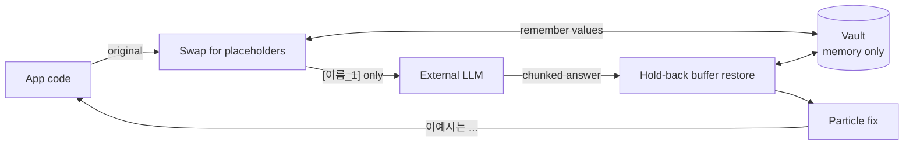
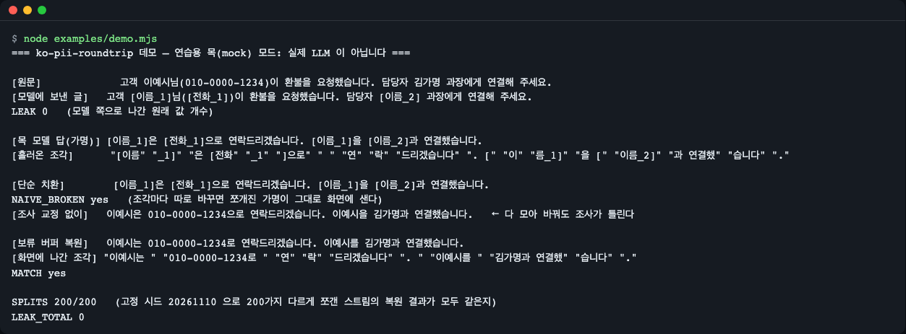
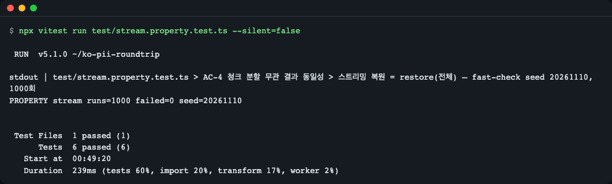

# ko-pii-roundtrip

[한국어](README.md) | **English**

A TypeScript library that swaps Korean personal data (names, resident registration numbers, phone, business and card numbers, bank accounts, emails) for reversible placeholders before an LLM call, and restores the originals in the answer. It keeps streaming responses intact however the chunks are split, and fixes Korean particles (은/는, 이/가, …) after restoring. Ships a Vercel AI SDK 7 middleware and an `openai` 7 client wrapper; zero runtime dependencies, Node >= 22.12, ESM and CJS. Install: `npm install ko-pii-roundtrip ai` (or `openai`). Everything below runs offline with a mock model; it is an aid, not a legal-compliance guarantee.

When a Korean-language service calls an external LLM, this library replaces personal data such as names, resident registration numbers and phone numbers with **reversible placeholders** (`[이름_1]`, "name 1") before sending, and **restores the original values** when the answer comes back. It does not break however a streamed answer is chunked, and it also fixes Korean particles that no longer fit after restoring (`이예시은` -> `이예시는`).

> This library is an **aid** for protecting personal data. It does not guarantee legal compliance, and name detection is a conservative heuristic that can miss cases ([limits](#detection-rules-and-limits)).

## Installation

With the AI SDK (`ai`):

```bash
npm install ko-pii-roundtrip ai
```

With the `openai` package:

```bash
npm install ko-pii-roundtrip openai
```

For the core only (detect, pseudonymize, restore), `ko-pii-roundtrip` alone is enough. `ai` and `openai` are **optional peer dependencies**; install them yourself only when you use the matching adapter (both `^7.0.0`). The mock examples below use `ai/test` (bundled with the AI SDK), so installing `ai` is all they need.

> If the package is not on the npm registry yet, you can install it straight from GitHub: `npm install github:LeeGyeongPil/ko-pii-roundtrip ai` (the `prepare` script builds it on install). If your npm blocks install scripts, `dist/` is not built; in that case clone the repo and build with `npm install && npm run build`. Building from source (including the `prepare` step of a GitHub install) needs **Node.js 22.18 or later** because of the build tool (tsdown). If you only consume the package, 22.12 or later is enough.

- Supported environments: **Node.js 22.12 or later** (`engines.node`), both ESM and CJS. TypeScript types included.
- Runtime dependencies: **none**.

## Quick start

The simplest form uses only the core functions. No network or key is needed.

`examples/quickstart-core.mjs`

```js
// Minimal core-only example: detect -> pseudonymize -> restore (no network or key needed)
import { createVault, detect, pseudonymize, restore } from 'ko-pii-roundtrip';

const vault = createVault(); // one vault per conversation (memory only)
const memo = '고객 이예시님(010-0000-1234)이 환불 요청. 주민 990101-3000012, 국민은행 000-000-001234';

for (const d of detect(memo)) console.log(d.kind, JSON.stringify(d.value), d.confidence);

const sent = pseudonymize(memo, vault);
console.log(sent); // only this text goes to the model
console.log(JSON.stringify(vault)); // original values are not printed

const answer = '[이름_1]은 [전화_1]으로 연락하고 [계좌_1]로 환불합니다.'; // pretend this is the model's answer
console.log(restore(answer, vault));
console.log(restore(answer, vault, { josa: false }));
```

```text
name "이예시" context
phone "010-0000-1234" format
rrn "990101-3000012" checksum
account "000-000-001234" context
고객 [이름_1]님([전화_1])이 환불 요청. 주민 [주민번호_1], 국민은행 [계좌_1]
{"redacted":true,"size":4}
이예시는 010-0000-1234로 연락하고 000-000-001234로 환불합니다.
이예시은 010-0000-1234으로 연락하고 000-000-001234로 환불합니다.
```

How to read it: `detect` finds 4 items (kind, value, confidence), `pseudonymize` builds the text to send to the model, and `restore` turns `[이름_1]` and the like in the model's answer back into the originals. The last two lines show the result with particle correction on (`이예시는`, `…1234로`) and off (`이예시은`, `…1234으로`).

## Core concepts



- **Placeholder**: a stand-in of the form `[label_number]`. The same value always gets the same placeholder (`이예시` -> always `[이름_1]`), so the model can tell it is "the same person". It is like putting a numbered tag on a letter instead of a name, then swapping the tag back to the name when the reply arrives.
- **Vault**: the value <-> placeholder table. It lives **in memory only**, and your app decides its lifetime (usually one per conversation). Pass the same vault on the next turn of the same conversation so the same person keeps the same placeholder. `JSON.stringify(vault)` does not emit original values, only the count.
- **Hold-back buffer**: a streamed answer arrives in pieces such as `"[이름"` + `"_1]"`. Replacing each piece separately would leak placeholders to the screen. This library holds back only the tail whose verdict could change if more characters arrive, and emits the rest right away. A fixed-seed property test (1000 runs) checks that any way of splitting gives the same result as restoring in one pass.
- **Particle fix**: the model often attaches `은` after `[이름_1]` to match the sound of `1` (il). If the restored value is `이예시` (no final consonant), the particle should be `는`, so the particle right after it is chosen again.

## Usage examples

### 1. Vercel AI SDK middleware

Create one `createVault()` per conversation and wrap the model with `wrapLanguageModel`. Prompts go out with placeholders, and `generateText` / `streamText` results come back restored.

`examples/quickstart-ai-sdk.mjs` — uses a practice mock model, so no key is needed.

```js
// Vercel AI SDK middleware example — a practice mock model, so no key or network is needed.
// To use a real model, put the provider's model (e.g. openai('...')) in place of `model: mock`.
import { streamText, wrapLanguageModel } from 'ai';
import { convertArrayToReadableStream, MockLanguageModelV4 } from 'ai/test';
import { createVault } from 'ko-pii-roundtrip';
import { piiMiddleware } from 'ko-pii-roundtrip/ai-sdk';

const usage = {
  inputTokens: { total: 1, noCache: 1, cacheRead: 0, cacheWrite: 0 },
  outputTokens: { total: 1, text: 1, reasoning: 0 },
};
// Mock model: deliberately streams in small pieces so placeholders get split between chunks
const pieces = ['[이름', '_1]', '은 [전', '화_1]으', '로 연락', '드립니다.'];
const mock = new MockLanguageModelV4({
  doStream: async () => ({
    stream: convertArrayToReadableStream([
      { type: 'stream-start', warnings: [] },
      { type: 'text-start', id: 't0' },
      ...pieces.map((delta) => ({ type: 'text-delta', id: 't0', delta })),
      { type: 'text-end', id: 't0' },
      { type: 'finish', finishReason: { unified: 'stop', raw: 'stop' }, usage },
    ]),
  }),
});

const vault = createVault();
const model = wrapLanguageModel({ model: mock, middleware: piiMiddleware({ vault }) });

const result = streamText({ model, prompt: '고객 이예시님(010-0000-1234)이 환불을 요청했습니다.' });
const shown = [];
for await (const delta of result.textStream) shown.push(delta);

console.log('모델이 받은 글:', mock.doStreamCalls[0].prompt.at(-1).content[0].text);
console.log('화면에 나간 조각:', JSON.stringify(shown));
console.log('이어 붙인 글:', shown.join(''));
```

```text
모델이 받은 글: 고객 [이름_1]님([전화_1])이 환불을 요청했습니다.
화면에 나간 조각: ["이예시는 ","010-0000-1234로 연락","드립니다."]
이어 붙인 글: 이예시는 010-0000-1234로 연락드립니다.
```

(The output labels read: "text the model received", "pieces shown on screen", "joined text".)

- The text the model received contains no original values. The pieces shown on screen come out grouped like `이예시는 `, with no placeholder fragments leaking.
- The argument JSON of tool calls (`tool-call`, `tool-input-delta`) is restored too. The JSON does not break even if the original value contains `"` or `\`. File parts such as images and PDFs are not pseudonymized.
- **Middleware order**: if you also use logging or cache middleware, place it **after** the pseudonym middleware (closer to the model). With `middleware: [pii, logging]` the pseudonym middleware is outermost, so logging sees only placeholders.
- To use a real model, put the provider model in place of `model: mock`. All output in this README comes from a **practice mock**, and a real model may return placeholders altered ([limits](#detection-rules-and-limits)).

### 2. `openai` client wrapper

`wrapOpenAI(client, { vault })` wraps `chat.completions.create`. Streaming and non-streaming calls work the same way.

`examples/quickstart-openai.mjs` — a practice mock that imitates a streaming response with a fake `fetch`.

```js
// openai client wrapper example — imitates a streaming response with a fake fetch (no key or network needed).
// In real use, do not pass `fetch`, `baseURL` or `apiKey`; use `new OpenAI()` as is.
import OpenAI from 'openai';
import { createVault } from 'ko-pii-roundtrip';
import { wrapOpenAI } from 'ko-pii-roundtrip/openai';

const pieces = ['[이름', '_1]', '은 [전', '화_1]으', '로 연락', '드립니다.'];
let requestBody = '';
const fakeFetch = async (_url, init) => {
  requestBody = String(init.body);
  const chunk = (delta, finish = null) =>
    `data: ${JSON.stringify({
      id: 'x', object: 'chat.completion.chunk', created: 0, model: 'mock',
      choices: [{ index: 0, delta, finish_reason: finish }],
    })}\n\n`;
  const body = [
    chunk({ role: 'assistant' }),
    ...pieces.map((p) => chunk({ content: p })),
    chunk({}, 'stop'),
    'data: [DONE]\n\n',
  ].join('');
  return new Response(body, { status: 200, headers: { 'content-type': 'text/event-stream' } });
};

const client = wrapOpenAI(
  new OpenAI({ apiKey: 'mock', baseURL: 'http://mock.invalid/v1', fetch: fakeFetch, maxRetries: 0 }),
  { vault: createVault() },
);

const stream = await client.chat.completions.create({
  model: 'mock',
  stream: true,
  messages: [{ role: 'user', content: '고객 이예시님(010-0000-1234)이 환불을 요청했습니다.' }],
});
let shown = '';
for await (const chunk of stream) shown += chunk.choices[0]?.delta?.content ?? '';

console.log('서버가 받은 요청:', JSON.parse(requestBody).messages[0].content);
console.log('복원된 답:', shown);
```

```text
서버가 받은 요청: 고객 [이름_1]님([전화_1])이 환불을 요청했습니다.
복원된 답: 이예시는 010-0000-1234로 연락드립니다.
```

(The output labels read: "request the server received", "restored answer".)

### 3. Using the stream restorer and the tool-argument (JSON) restorer directly

To plug into your own stream without an adapter, use `createStreamRestorer`. `push` each piece, and call `flush` **once at the end** (the held-back tail comes out).

`examples/stream-and-json.mjs`

```js
// Stream restorer and JSON argument restorer (for tool calls) example — no network needed
import { createJsonStringRestorer, createStreamRestorer, createVault, pseudonymize } from 'ko-pii-roundtrip';

const vault = createVault();
pseudonymize('고객 이예시님(010-0000-1234)', vault); // creates [이름_1], [전화_1]

// 1) Text stream: pieces may be cut right in the middle of a placeholder
const r = createStreamRestorer(vault);
const pieces = ['[이름', '_1]', '은 [전', '화_1]으', '로 연락'];
const out = pieces.map((p) => r.push(p));
out.push(r.flush()); // always call once when the stream ends
console.log(JSON.stringify(out));
console.log(out.join(''));

// 2) Tool-argument (JSON string) stream: the restored value is escaped so it cannot break the JSON
const quoted = createVault();
quoted.tokenFor('name', '김"가명');
const j = createJsonStringRestorer(quoted);
const args = ['{"name":"[이름', '_1]"}'].map((p) => j.push(p)).join('') + j.flush();
console.log(args);
console.log(JSON.parse(args).name);
```

```text
["","","이예시는 ","","010-0000-1234로 연락",""]
이예시는 010-0000-1234로 연락
{"name":"김\"가명"}
김"가명
```

The empty strings in the first line are pieces "held back because no verdict is possible yet". The joined result equals a single `restore` over the whole text.

### 4. CommonJS

`examples/quickstart-cjs.cjs` — on Node 22.12 or later, `require()` can load ESM packages (`ai`) too.

```js
// Using it from CommonJS — Node 22.12+ can also load ESM packages (ai) with require()
const { createVault, pseudonymize, restore } = require('ko-pii-roundtrip');
const { piiMiddleware } = require('ko-pii-roundtrip/ai-sdk');
const { wrapLanguageModel } = require('ai');

const vault = createVault();
const sent = pseudonymize('고객 이예시님(010-0000-1234)이 환불 요청', vault);
console.log(sent);
console.log(restore('[이름_1]은 [전화_1]으로 연락드립니다.', vault));
console.log(typeof wrapLanguageModel, typeof piiMiddleware);
```

```text
고객 [이름_1]님([전화_1])이 환불 요청
이예시는 010-0000-1234로 연락드립니다.
function function
```

### 5. Using particle correction directly

`examples/josa-table.mjs`

```js
// Final-consonant check and particle picking example — no network needed
import { attachJosa, hasBatchim } from 'ko-pii-roundtrip';

const cases = [
  ['이예시', '은/는'],
  ['김가명', '은/는'],
  ['서울', '으로/로'],
  ['010-0000-5678', '으로/로'],
  ['010-0000-1234', '과/와'],
  ['gamyeong.kim@example.com', '이/가'],
];
for (const [word, pair] of cases) console.log(`${word} + ${pair} -> ${attachJosa(word, pair)}  (받침: ${hasBatchim(word)})`);
```

```text
이예시 + 은/는 -> 이예시는  (받침: false)
김가명 + 은/는 -> 김가명은  (받침: true)
서울 + 으로/로 -> 서울로  (받침: true)
010-0000-5678 + 으로/로 -> 010-0000-5678로  (받침: true)
010-0000-1234 + 과/와 -> 010-0000-1234와  (받침: false)
gamyeong.kim@example.com + 이/가 -> gamyeong.kim@example.com이  (받침: true)
```

(`받침` means "final consonant".)

The final-consonant check goes by the final consonant of a Hangul syllable; for digits, by the sound of reading each digit one by one (0 yeong, 1 il, 3 sam, 6 yuk, 7 chil and 8 pal have one; 2, 4, 5 and 9 do not); for Latin letters, by the letter name (only L el, M em, N en and R al have one). `으로/로` takes `로` after a ㄹ final (`서울로`). For values that cannot be judged (ending in a symbol, for example), the particle the model wrote is left as is.

### 6. The whole flow at a glance (practice mock demo)

If you cloned the repository, one command shows the whole scene.

```bash
git clone https://github.com/LeeGyeongPil/ko-pii-roundtrip.git
cd ko-pii-roundtrip
npm install
npm run example
```

`npm run example` builds first (the tsdown log prints first), then runs `examples/demo.mjs`. Below is that demo's output.

```text
=== ko-pii-roundtrip 데모 — 연습용 목(mock) 모드: 실제 LLM 이 아닙니다 ===

[원문]             고객 이예시님(010-0000-1234)이 환불을 요청했습니다. 담당자 김가명 과장에게 연결해 주세요.
[모델에 보낸 글]   고객 [이름_1]님([전화_1])이 환불을 요청했습니다. 담당자 [이름_2] 과장에게 연결해 주세요.
LEAK 0   (모델 쪽으로 나간 원래 값 개수)

[목 모델 답(가명)] [이름_1]은 [전화_1]으로 연락드리겠습니다. [이름_1]을 [이름_2]과 연결했습니다.
[흘러온 조각]      "[이름" "_1]" "은 [전화" "_1" "]으로" " " "연" "락" "드리겠습니다" ". [" "이" "름_1]" "을 [" "이름_2]" "과 연결했" "습니다" "." 

[단순 치환]        [이름_1]은 [전화_1]으로 연락드리겠습니다. [이름_1]을 [이름_2]과 연결했습니다.
NAIVE_BROKEN yes   (조각마다 따로 바꾸면 쪼개진 가명이 그대로 화면에 샌다)
[조사 교정 없이]   이예시은 010-0000-1234으로 연락드리겠습니다. 이예시을 김가명과 연결했습니다.   ← 다 모아 바꿔도 조사가 틀린다

[보류 버퍼 복원]   이예시는 010-0000-1234로 연락드리겠습니다. 이예시를 김가명과 연결했습니다.
[화면에 나간 조각] "이예시는 " "010-0000-1234로 " "연" "락" "드리겠습니다" ". " "이예시를 " "김가명과 연결했" "습니다" "."
MATCH yes

SPLITS 200/200   (고정 시드 20261110 으로 200가지 다르게 쪼갠 스트림의 복원 결과가 모두 같은지)
LEAK_TOTAL 0
```

(Gloss of the output: "demo — practice mock mode: not a real LLM"; "original text"; "text sent to the model"; "number of original values that went out to the model"; "mock model answer (placeholders)"; "pieces that streamed in"; "naive replacement"; "if replaced piece by piece, split placeholders leak to the screen as they are"; "without particle fix"; "even when replaced after gathering everything, the particles are wrong"; "hold-back buffer restore"; "pieces shown on screen"; "whether the restored results of 200 differently split streams with fixed seed 20261110 are all identical".)



*Figure 1. The practice mock demo. The text that went out to the model contains only placeholders (`LEAK 0`), and replacing piece by piece leaks fragments like `[이름` (`NAIVE_BROKEN yes`). The hold-back buffer restore gives the same result for all 200 splits (`SPLITS 200/200`).*

This demo is a **practice mock, not a real LLM**. The mock model quotes placeholders exactly and streams them in pieces of 1 to 6 characters chosen at random (fixed seed). A real model may return placeholders changed to something like `[이름 1]` or `[Name_1]`, and those cannot be restored (see the limits below).

## Detection rules and limits

`detect(text)` runs the 8 default detectors and returns a list of `{ kind, value, start, end, confidence }`. When matches overlap, only one is kept, in the order: longer first, then higher confidence, then earlier position.

| kind | Target | How it is judged | Default placeholder label |
|---|---|---|---|
| `rrn` | Resident registration number | Format + a birth date that exists on the calendar + gender digit (1-4). The checksum is not a rejection condition but is used only for `confidence` (`checksum`/`format`) | `주민번호` |
| `frn` | Foreigner registration number | Same as above, gender digit 5-8 | `외국인번호` |
| `brn` | Business registration number | Weighted checksum required | `사업자번호` |
| `phone` | Mobile (01x) and landline (area code) phone numbers, including `+82` international notation | Format joined by the same separator | `전화` |
| `card` | Card number | Luhn checksum required | `카드` |
| `account` | Bank account number | A bank name must appear within 20 characters on the same line | `계좌` |
| `email` | Email | Format | `이메일` |
| `name` | Name | Conservative: honorifics and titles (`이예시님`, `김가명 과장`), a preceding context word (고객, 성명, 담당자, 예금주, etc.) + particle (for colon headings, a context word + 명 form such as `고객명:` or `환자명:` also works, as does the full-width colon `：`), and the user dictionary `names` | `이름` |

- **Digit strings without hyphens** cause many false positives, so they are caught only when the checksum is valid or there is surrounding context (`주민`, `사업자`, `카드`, etc.).
- The resident registration number checksum is meaningful only for numbers issued before October 2020, so a number that fails it is still detected but marked `confidence: 'format'`.
- To reduce false positives, **names without context are missed.** Put names you want caught without context into the dictionary. The shape differs per call: for the core `detect(text, { names: [...] })` and `pseudonymize(text, vault, { names: [...] })`, `names` goes directly in the options; the AI SDK and openai adapters wrap it one level deeper as `detect: { names: [...] }`.
- Names that can also read as a common word + particle (박사랑 = 박사 + 랑, 이상은 = 이상 + 은) are caught only when `님` or `씨` follows, or when they come after a colon heading such as `성명:`. `고객 박사랑`, `성명 박사랑` (no colon) and `하사랑 고객님` (spaced honorific) are missed, so put such names in the `names` dictionary. The order of judgment is "a bare title alone is excluded; an attached honorific or colon heading takes priority over the word reading". `고객명 홍길동` (a …명 heading without a colon) is missed, so use a colon as in `고객명: 홍길동` or put the name in the `names` dictionary.

**Not supported (0.1.3)**
- Phone numbers: country codes without `+` (`0082-…`, `82-…`), country codes in parentheses (`(+82) …`), forms mixing separators after the area code (such as `+82-10␣0000-1234`, where only some hyphens of `+82-10-0000-1234` are replaced by spaces), nationwide representative numbers (15xx, 16xx, 18xx), and other countries' numbers are not detected.
- Unknown option keys (typos and the like) are silently ignored. Check option names carefully (rejecting them is planned for a later version).
- A word after a name heading is treated as a name and replaced (the `고객님` in `성명: 고객님` and `고객명: 고객님` is also replaced). Only whitespace and colons (`:`, `：`) are recognized as separators, the full-width space (U+3000) is not, and `이상은 씨` (spaced `씨`) is missed.
- When the model alters a placeholder (`[이름 1]`, `이름_1`, `[Name_1]`), **only exactly matching placeholders** are restored.
- Particle correction covers only 6 pairs (은/는, 이/가, 을/를, 과/와, 으로/로, 이랑/랑). `이에요/예요`, `이라/라`, `으로서` and the copula `이다` are left as they are.
- Digits are judged by the sound of reading digit by digit, so numbers read by place value, such as amounts (10 -> 십), may differ.
- Two-character bare titles (박사님, 상무님, 하사님) and common three-character titles (정비사님, 진행자님, 상담원님) are not treated as names. However, with strong context such as `고객 정비원님` or `성명: 정비원`, three-character titles are treated as names too (erring toward over-replacement rather than leaks). A "word + 인" after a context word, as in `회원 정상인 경우`, may also be read as a name. This is an error on the side of unnecessary replacement, not leakage, and the answer restores the original word.
- Address, passport, driver's license and corporate registration number detection, ML-based name recognition, vault storage and encryption, and wrappers for ai@6, the openai Responses API and the Anthropic SDK.
- The JSON restorer finds placeholders only when they appear without escaping (it cannot find them if the model emits Hangul as `\uXXXX`).
- `openai`: only `chat.completions.create` is wrapped. The wrapped `create` returns a plain Promise, so `.withResponse()` and `.asResponse()` are absent, and the wrapped stream does not support `tee()` (`KoPiiError`).
- AI SDK: file parts (images, PDFs) of user messages are not pseudonymized. Only middleware spec v4 (ai@7) is supported.

## API

### `ko-pii-roundtrip`

| Name | What it does | Main arguments | Returns |
|---|---|---|---|
| `createVault(opts?)` | Creates the value <-> placeholder table (one per conversation) | `opts.labels`: change labels per kind (no spaces or brackets in labels) | `Vault` |
| `detect(text, opts?)` | Finds personal-data candidates | `opts.detectors`: detectors to enable (name or `Detector` object), `opts.names`: name dictionary | `Detection[]` |
| `pseudonymize(text, vault, opts?)` | Replaces found values with placeholders. Values the vault already knows get the same placeholder | `opts`: same as `detect` | `string` |
| `restore(text, vault, opts?)` | Turns placeholders back into original values (single pass, longest placeholder first) | `opts.josa`: particle correction (default `true`) | `string` |
| `createStreamRestorer(vault, opts?)` | Per-chunk restorer | `opts.josa` | `{ push(delta): string, flush(): string }` |
| `createJsonStringRestorer(vault, opts?)` | Restorer for JSON string (tool argument) chunks. Restored values are JSON-escaped when inserted | `opts.josa` | `{ push, flush }` |
| `restoreJsonText(json, vault, opts?)` | Restores a whole JSON string in one go | same | `string` |
| `hasBatchim(word)` | Whether the last character has a final consonant | Text ending in Hangul, digits or Latin letters | `boolean \| null` (`null` if it cannot be judged) |
| `pickJosa(word, pair)` | Picks only the particle that fits the value | `pair`: `'은/는'`, `'이/가'`, `'을/를'`, `'과/와'`, `'으로/로'`, `'이랑/랑'` | `string \| null` |
| `attachJosa(word, pair)` | Attaches value + particle | same | `string` |
| `createNameDetector(names?)` | Creates a name detector with a user dictionary | Array of names | `Detector` |
| `detectors` | The 8 default detector objects | — | `Record<PiiKind, Detector>` |
| `DEFAULT_LABELS` | Default label table | — | `Record<PiiKind, string>` |
| `KoPiiError`, `UnknownDetectorError` | Usage error / unknown detector name | — | Exception classes |

Public functions check their arguments first and, if invalid, throw a single `KoPiiError` (the message includes how to fix it). `piiMiddleware` and `wrapOpenAI` check at creation; `detect`, `pseudonymize`, `restore` and `push` check at call time. Actual output (for `piiMiddleware({})`, `detect(null)`, `restore(null, vault)` and `createStreamRestorer(vault).push(undefined)` respectively):

```text
KoPiiError: piiMiddleware({ vault }) needs a vault, got undefined. Create one with createVault() and pass it in, e.g. { vault: createVault() }.
KoPiiError: detect(text) must be a string, got null. Convert it first, e.g. String(value) or value ?? ''.
KoPiiError: restore(text, vault) must be a string, got null. Convert it first, e.g. String(value) or value ?? ''.
KoPiiError: StreamRestorer.push(delta) must be a string, got undefined. Convert it first, e.g. String(value) or value ?? ''.
```

`Vault`: `tokenFor(kind, value, label?)`, `original(token)`, `size`, `tokens()`, `toJSON()`. Only vaults made with `createVault()` are accepted; implementing an object of the same shape yourself, or passing a copy such as `{ ...createVault() }`, raises `KoPiiError` (because a fake vault that returns original values would leak them straight to the model). A custom detector has the form `{ kind, label, find(text): Detection[] }`.

Types: `PiiKind`, `Confidence`, `Detection`, `Detector`, `DetectOptions`, `Vault`, `VaultOptions`, `JosaPair`, `RestoreOptions`, `StreamRestorer`.

### `ko-pii-roundtrip/ai-sdk`

| Name | What it does | Main arguments | Returns |
|---|---|---|---|
| `piiMiddleware(opts)` | AI SDK 7 language model middleware (spec v4) | `vault` (required), `detect`, `restoreReasoning` (default `true`), `josa` (default `true`) | `PiiMiddleware` |

### `ko-pii-roundtrip/openai`

| Name | What it does | Main arguments | Returns |
|---|---|---|---|
| `wrapOpenAI(client, opts)` | A client with `chat.completions.create` wrapped | `vault` (required), `detect`, `josa` (default `true`) | The wrapped `client` (same type) |

## Why streaming restore does not break

The key is "stop only at points where more characters arriving could change the verdict". There are only three places it stops.

1. When the tail is the beginning of some placeholder (`[이름_`). If it is the beginning of a longer placeholder, it waits even if a shorter placeholder already matched.
2. When the particle right after a placeholder cannot be judged yet (long particles such as `이랑`/`으로` and the boundary character after them must be seen).
3. When the tail is the first half of a surrogate pair such as an emoji (so a broken character is never shown on screen).

The amount held back never exceeds "the longest placeholder + 3 characters", so memory and display latency do not grow as the stream gets longer. Verdicts are made looking only at text after that position, so re-reading from the stopping point gives the same result as reading everything at once, and this is verified with fast-check.

```bash
npx vitest run test/stream.property.test.ts --silent=false
```



*Figure 2. Across 1000 arbitrary splits (including empty pieces, 1-character pieces and splits in the middle of an emoji), the restored result is identical to restoring in one pass (0 counterexamples, seed 20261110).*

## When to use it

- Use it when: in a Node service that summarizes, classifies or drafts replies from Korean consultation notes, complaints or customer memos with an external LLM, you want to keep names, resident registration numbers, phone numbers and accounts away from the model while reading original values in the answer. Also when you want streaming responses and tool-call arguments handled the same way.
- Use another tool when: for general English-centered PII detection and masking, see [Microsoft Presidio](https://microsoft.github.io/presidio/) (Python); if you want a separate proxy server in front of the model, look for a proxy-style tool. This library does not judge legal suitability.
- Not a fit for now: environments where the model rewrites placeholders (loose matching is not supported), and cases that need address, passport or driver's license detection.

## Troubleshooting

| Symptom | Cause | Fix |
|---|---|---|
| `engine` warning or `require() of ES Module` error on install or run | Node older than 22.12. `require`-ing an ESM package (`ai`) from CJS needs Node 22.12 or later | Upgrade to Node 22.12 or later (check with `node -v`, e.g. `nvm install 22`) |
| `ERR_REQUIRE_ESM` in CommonJS | Node older than 22.12, or an environment that `require`s `ai` | Use Node 22.12 or later, or write the file as ESM (`.mjs` or `"type": "module"`) and `import`. This package itself ships both ESM and CJS |
| On Node 22.12, an `ExperimentalWarning: CommonJS module ... is loading ES Module ... using require()` warning appears on stderr | `require(esm)` in 22.12 carries an experimental-feature warning. It does not affect output (on 22.12.0 the CJS example output in this README came out unchanged) | The warning can be ignored |
| `Cannot find package 'ai'` / `'openai'` | They are optional peer dependencies and are not installed automatically | `npm install ai` or `npm install openai` |
| `ai/test` not found | The mock examples use `ai/test` from the `ai` package | `npm install ai` (7.x) |
| In TypeScript, `Cannot find module 'ko-pii-roundtrip/ai-sdk'` | `moduleResolution` is `node` (the old mode) and cannot read `exports` | In `tsconfig.json`, change to `"module": "nodenext"` (or `"moduleResolution": "bundler"`) |
| Particles are off on screen, as in `이예시은` | Turned off with `josa: false`, or the value ends in a symbol so the final consonant cannot be judged | Keep the `josa` option on (the default), and keep in mind that for values that cannot be judged the model's particle stays |
| `[이름_1]` is not restored and appears as is in the answer | The model altered the placeholder to `[이름 1]` or `[Name_1]`, or a different vault is used | It must match exactly to be restored (current limit). Pass the same vault for the same conversation |
| A `KoPiiError` appears, such as `KoPiiError: piiMiddleware({ vault }) needs a vault, got undefined` | A required argument (vault) was not passed, or a non-string (`null`, `undefined`) was passed to `detect`, `restore` or `push` | Pass `{ vault: createVault() }` as the message says, or convert to a string with `String(value)` or `value ?? ''` (see the error examples in the API section) |
| A name is not replaced | Names without an honorific or context are not detected | Add it to the dictionary with `detect: { names: ['박샘플'] }`, or send it with `님` or a title attached |
| The last few characters do not appear at the end of the stream | You use `createStreamRestorer` directly and did not call `flush()` | Call `flush()` once when the stream ends |
| Original values show up in logs | The logging middleware is outside (in front of) the pseudonym middleware | Place logging and cache **after** the pseudonym middleware (closer to the model) |

## Versions and compatibility

- Follows Semantic Versioning (SemVer). During 0.x, the API may change in minor versions, and changes are recorded in [CHANGELOG.md](CHANGELOG.md).
- Node.js >= 22.12, `ai` ^7.0.0 (optional), `openai` ^7.0.0 (optional). ESM and CJS consumer regressions are checked in CI on Node 22.12.0, 24 and 26 (the Node 24 result in CI is pending its first run).
- This repository opens no ports and sends no network requests. For security matters, see [SECURITY.md](SECURITY.md).

## Development and contributing

```bash
npm install         # building (tsdown) needs Node 22.18 or later (.nvmrc)
npm test            # build + type check + tests (308)
npm run example     # practice mock demo
npm run test:consumers   # install the build output into temporary projects (ESM and CJS) and check it
```

The resident registration, phone, account and card numbers in tests, examples and docs are all **synthetic values** with only the checksum made valid; they are not real information.

## Learn more

- News report on the Personal Information Protection Commission's guidance on handling personal data with generative AI (2025-08): https://byline.network/2025/08/6-277/ (checked 2026-11-10)
- Vercel AI SDK language model middleware: https://ai-sdk.dev/docs/ai-sdk-core/middleware
- OpenAI Node SDK: https://github.com/openai/openai-node
- Entities supported by Microsoft Presidio (for Korea, mainly the resident registration number): https://microsoft.github.io/presidio/supported_entities

## License

MIT.
