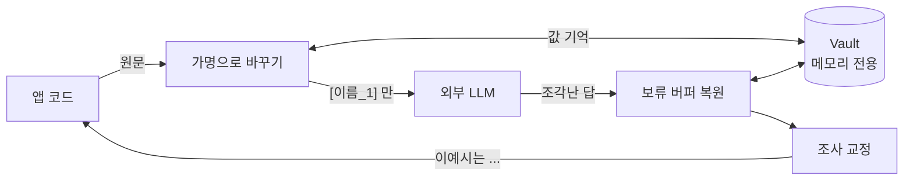
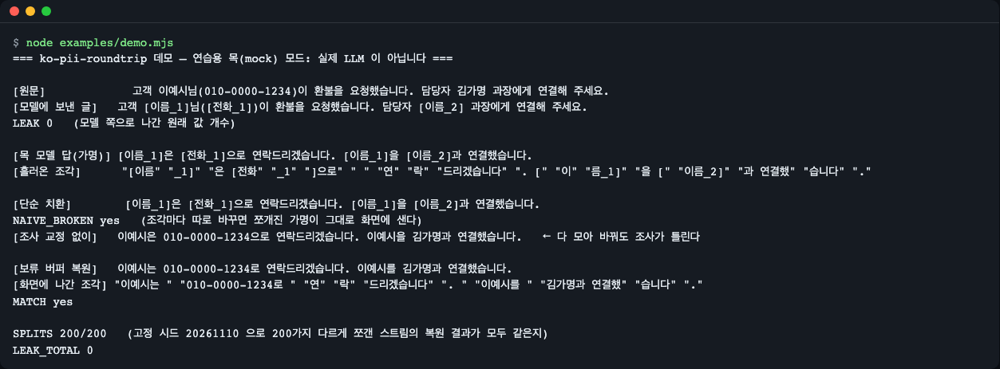
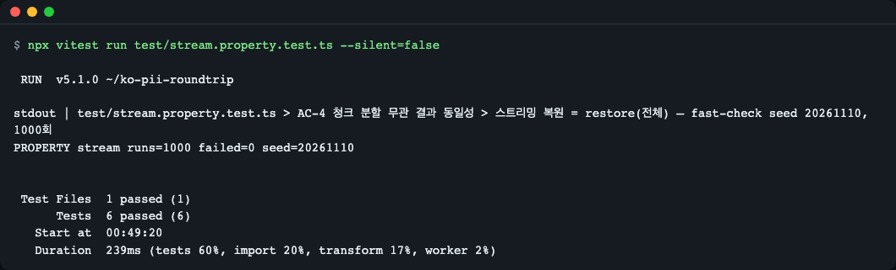

# ko-pii-roundtrip

> **English summary** — A TypeScript library that swaps Korean personal data (names, resident registration numbers, phone, business and card numbers, bank accounts, emails) for reversible placeholders before an LLM call, and restores the originals in the answer. It keeps streaming responses intact however the chunks are split, and fixes Korean particles (은/는, 이/가, …) after restoring. Ships a Vercel AI SDK 7 middleware and an `openai` 7 client wrapper; zero runtime dependencies, Node >= 22.12, ESM and CJS. Install: `npm install ko-pii-roundtrip ai` (or `openai`). Everything below runs offline with a mock model; it is an aid, not a legal-compliance guarantee.

한국어 서비스에서 외부 LLM을 부를 때, 이름·주민등록번호·전화번호 같은 개인정보를 **되돌릴 수 있는 가명**(`[이름_1]`)으로 바꿔 보내고, 답이 돌아오면 **원래 값으로 복원**합니다. 스트리밍 답이 어떻게 쪼개져 와도 깨지지 않고, 복원한 뒤 어긋난 조사(`이예시은` → `이예시는`)까지 고칩니다.

> 이 라이브러리는 개인정보 보호 조치를 돕는 **보조 수단**입니다. 법적 준수를 보장하지 않으며, 이름 탐지는 보수적인 휴리스틱이라 놓치는 경우가 있습니다([한계](#탐지-규칙과-한계)).

## 설치

AI SDK(`ai`)와 함께 쓸 때:

```bash
npm install ko-pii-roundtrip ai
```

`openai` 패키지와 함께 쓸 때:

```bash
npm install ko-pii-roundtrip openai
```

코어(탐지·가명·복원)만 쓰면 `ko-pii-roundtrip` 하나면 됩니다. `ai`·`openai`는 **선택 peer 의존성**이라, 해당 어댑터를 쓸 때만 직접 설치합니다(둘 다 `^7.0.0`). 아래 목(mock) 예제는 `ai/test`(AI SDK에 들어 있음)를 쓰므로 `ai` 설치만으로 돌아갑니다.

> npm 레지스트리에 아직 올리기 전이라면 GitHub에서 바로 설치할 수 있습니다: `npm install github:LeeGyeongPil/ko-pii-roundtrip ai` (설치 때 `prepare` 스크립트가 빌드합니다). 사용 중인 npm 이 설치 스크립트를 막으면 `dist/` 가 만들어지지 않으므로, 그때는 clone 한 뒤 `npm install && npm run build` 로 빌드해서 쓰세요. 소스에서 빌드하려면(GitHub 설치의 `prepare` 포함) 빌드 도구(tsdown) 때문에 **Node.js 22.18 이상**이 필요합니다. 패키지를 가져다 쓰기만 한다면 22.12 이상이면 됩니다.

- 지원 환경: **Node.js 22.12 이상**(`engines.node`), ESM·CJS 둘 다. TypeScript 타입 포함.
- 런타임 의존성: **0개**.

## 빠르게 시작하기

가장 단순한 형태 — 코어 함수만 씁니다. 네트워크·키가 필요 없습니다.

`examples/quickstart-core.mjs`

```js
// 코어만 쓰는 최소 예제: 탐지 → 가명 → 복원 (네트워크·키 불필요)
import { createVault, detect, pseudonymize, restore } from 'ko-pii-roundtrip';

const vault = createVault(); // 대화 하나당 vault 하나(메모리 전용)
const memo = '고객 이예시님(010-0000-1234)이 환불 요청. 주민 990101-3000012, 국민은행 000-000-001234';

for (const d of detect(memo)) console.log(d.kind, JSON.stringify(d.value), d.confidence);

const sent = pseudonymize(memo, vault);
console.log(sent); // 모델에는 이 글만 보낸다
console.log(JSON.stringify(vault)); // 원래 값은 찍히지 않는다

const answer = '[이름_1]은 [전화_1]으로 연락하고 [계좌_1]로 환불합니다.'; // 모델 답이라고 가정
console.log(restore(answer, vault));
console.log(restore(answer, vault, { josa: false }));
```

```text
name "이예시" context
phone "010-0000-1234" format
rrn "990101-3000012" checksum
account "000-000-001234" context
고객 [이름_1]님([전화_1])이 환불 요청. 주민 [주민번호_1], 국민은행 [계좌_1]
{"redacted":true,"size":4}
이예시는 010-0000-1234로 연락하고 000-000-001234로 환불합니다.
이예시은 010-0000-1234으로 연락하고 000-000-001234로 환불합니다.
```

읽는 법: `detect` 가 찾은 것 4개(종류·값·신뢰도), `pseudonymize` 가 모델에 보낼 글을 만들고, `restore` 가 모델 답의 `[이름_1]` 등을 되돌립니다. 마지막 두 줄은 조사 교정을 켰을 때(`이예시는`, `…1234로`)와 껐을 때(`이예시은`, `…1234으로`)입니다.

## 핵심 개념



- **가명(placeholder)**: `[라벨_번호]` 꼴의 자리표시자입니다. 같은 값은 같은 가명(`이예시` → 항상 `[이름_1]`)이라 모델이 "같은 사람"임을 알 수 있습니다. 우편물에 이름 대신 번호표를 붙여 보내고, 돌아온 답장의 번호표를 다시 이름으로 바꿔 읽는 것과 같습니다.
- **Vault**: 값 ↔ 가명 표입니다. **메모리에만** 있고, 수명은 앱이 정합니다(보통 대화 하나당 하나). 같은 대화의 다음 턴에도 같은 vault 를 넘겨야 같은 사람이 같은 가명을 받습니다. `JSON.stringify(vault)` 는 원래 값을 내보내지 않고 개수만 냅니다.
- **보류 버퍼**: 스트리밍 답은 `"[이름"` + `"_1]"` 처럼 조각나 옵니다. 조각마다 따로 바꾸면 가명이 화면에 샙니다. 이 라이브러리는 "뒤 글자가 더 오면 판단이 바뀔 수 있는 꼬리"만 잠시 붙잡아 두고 나머지는 바로 내보냅니다. 어떻게 쪼개도 한 번에 복원한 결과와 같다는 점을 고정 시드 속성 테스트(1000회)로 확인합니다.
- **조사 교정**: 모델은 `[이름_1]` 뒤에 `1(일)` 소리에 맞춰 `은` 을 붙이곤 합니다. 복원한 값이 `이예시`(받침 없음)면 `는` 이어야 하므로 바로 뒤 조사를 다시 고릅니다.

## 사용 예

### 1. Vercel AI SDK 미들웨어

대화 하나당 `createVault()` 하나를 만들고, 모델을 `wrapLanguageModel` 로 감쌉니다. 프롬프트는 가명으로 바뀌어 나가고, `generateText`·`streamText` 결과는 복원돼 돌아옵니다.

`examples/quickstart-ai-sdk.mjs` — 연습용 목(mock) 모델이라 키가 필요 없습니다.

```js
// Vercel AI SDK 미들웨어 예제 — 연습용 목(mock) 모델이라 키·네트워크가 필요 없다.
// 실제 모델을 쓰려면 `model: mock` 자리에 provider 의 모델(예: openai('...'))을 넣는다.
import { streamText, wrapLanguageModel } from 'ai';
import { convertArrayToReadableStream, MockLanguageModelV4 } from 'ai/test';
import { createVault } from 'ko-pii-roundtrip';
import { piiMiddleware } from 'ko-pii-roundtrip/ai-sdk';

const usage = {
  inputTokens: { total: 1, noCache: 1, cacheRead: 0, cacheWrite: 0 },
  outputTokens: { total: 1, text: 1, reasoning: 0 },
};
// 목 모델: 가명이 조각 사이에서 쪼개지도록 일부러 잘게 나눠 흘린다
const pieces = ['[이름', '_1]', '은 [전', '화_1]으', '로 연락', '드립니다.'];
const mock = new MockLanguageModelV4({
  doStream: async () => ({
    stream: convertArrayToReadableStream([
      { type: 'stream-start', warnings: [] },
      { type: 'text-start', id: 't0' },
      ...pieces.map((delta) => ({ type: 'text-delta', id: 't0', delta })),
      { type: 'text-end', id: 't0' },
      { type: 'finish', finishReason: { unified: 'stop', raw: 'stop' }, usage },
    ]),
  }),
});

const vault = createVault();
const model = wrapLanguageModel({ model: mock, middleware: piiMiddleware({ vault }) });

const result = streamText({ model, prompt: '고객 이예시님(010-0000-1234)이 환불을 요청했습니다.' });
const shown = [];
for await (const delta of result.textStream) shown.push(delta);

console.log('모델이 받은 글:', mock.doStreamCalls[0].prompt.at(-1).content[0].text);
console.log('화면에 나간 조각:', JSON.stringify(shown));
console.log('이어 붙인 글:', shown.join(''));
```

```text
모델이 받은 글: 고객 [이름_1]님([전화_1])이 환불을 요청했습니다.
화면에 나간 조각: ["이예시는 ","010-0000-1234로 연락","드립니다."]
이어 붙인 글: 이예시는 010-0000-1234로 연락드립니다.
```

- 모델이 받은 글에는 원래 값이 없습니다. 화면에 나간 조각은 가명 조각이 샌 것 없이 `이예시는 ` 처럼 묶여 나옵니다.
- 도구 호출(`tool-call`·`tool-input-delta`)의 인자 JSON 도 복원합니다. 원래 값에 `"`·`\` 가 있어도 JSON 이 깨지지 않습니다. 이미지·PDF 같은 파일 파트는 가명 처리하지 않습니다.
- **미들웨어 순서**: 로깅·캐시 미들웨어를 함께 쓰면 가명 미들웨어보다 **뒤**(모델 쪽)에 두세요. `middleware: [pii, logging]` 처럼 가명 미들웨어가 바깥이어야 로깅이 가명만 봅니다.
- 실제 모델을 쓰려면 `model: mock` 자리에 provider 모델을 넣으면 됩니다. 이 README의 출력은 전부 **연습용 목**이고, 실제 모델은 가명을 변형해서 돌려줄 수 있습니다([한계](#탐지-규칙과-한계)).

### 2. `openai` 클라이언트 래퍼

`wrapOpenAI(client, { vault })` 가 `chat.completions.create` 를 감쌉니다. 스트리밍·비스트리밍 모두 같은 호출 방식입니다.

`examples/quickstart-openai.mjs` — 가짜 `fetch` 로 스트리밍 응답을 흉내 내는 연습용 목입니다.

```js
// openai 클라이언트 래퍼 예제 — 가짜 fetch 로 스트리밍 응답을 흉내 낸다(키·네트워크 불필요).
// 실제로는 `fetch`·`baseURL`·`apiKey` 를 넘기지 않고 `new OpenAI()` 를 그대로 쓴다.
import OpenAI from 'openai';
import { createVault } from 'ko-pii-roundtrip';
import { wrapOpenAI } from 'ko-pii-roundtrip/openai';

const pieces = ['[이름', '_1]', '은 [전', '화_1]으', '로 연락', '드립니다.'];
let requestBody = '';
const fakeFetch = async (_url, init) => {
  requestBody = String(init.body);
  const chunk = (delta, finish = null) =>
    `data: ${JSON.stringify({
      id: 'x', object: 'chat.completion.chunk', created: 0, model: 'mock',
      choices: [{ index: 0, delta, finish_reason: finish }],
    })}\n\n`;
  const body = [
    chunk({ role: 'assistant' }),
    ...pieces.map((p) => chunk({ content: p })),
    chunk({}, 'stop'),
    'data: [DONE]\n\n',
  ].join('');
  return new Response(body, { status: 200, headers: { 'content-type': 'text/event-stream' } });
};

const client = wrapOpenAI(
  new OpenAI({ apiKey: 'mock', baseURL: 'http://mock.invalid/v1', fetch: fakeFetch, maxRetries: 0 }),
  { vault: createVault() },
);

const stream = await client.chat.completions.create({
  model: 'mock',
  stream: true,
  messages: [{ role: 'user', content: '고객 이예시님(010-0000-1234)이 환불을 요청했습니다.' }],
});
let shown = '';
for await (const chunk of stream) shown += chunk.choices[0]?.delta?.content ?? '';

console.log('서버가 받은 요청:', JSON.parse(requestBody).messages[0].content);
console.log('복원된 답:', shown);
```

```text
서버가 받은 요청: 고객 [이름_1]님([전화_1])이 환불을 요청했습니다.
복원된 답: 이예시는 010-0000-1234로 연락드립니다.
```

### 3. 스트림 복원기·도구 인자(JSON) 복원기 직접 쓰기

어댑터 없이 자기 스트림에 끼우려면 `createStreamRestorer` 를 씁니다. 조각을 `push` 하고, **끝나면 `flush` 를 한 번** 부릅니다(붙잡고 있던 꼬리가 나옵니다).

`examples/stream-and-json.mjs`

```js
// 스트리밍 복원기와 JSON 인자 복원기(도구 호출용) 예제 — 네트워크 불필요
import { createJsonStringRestorer, createStreamRestorer, createVault, pseudonymize } from 'ko-pii-roundtrip';

const vault = createVault();
pseudonymize('고객 이예시님(010-0000-1234)', vault); // [이름_1], [전화_1] 이 만들어진다

// 1) 글 스트림: 조각이 가명 한가운데서 끊겨도 된다
const r = createStreamRestorer(vault);
const pieces = ['[이름', '_1]', '은 [전', '화_1]으', '로 연락'];
const out = pieces.map((p) => r.push(p));
out.push(r.flush()); // 스트림이 끝나면 꼭 한 번 부른다
console.log(JSON.stringify(out));
console.log(out.join(''));

// 2) 도구 인자(JSON 문자열) 스트림: 복원한 값이 JSON 을 깨지 않도록 이스케이프해서 넣는다
const quoted = createVault();
quoted.tokenFor('name', '김"가명');
const j = createJsonStringRestorer(quoted);
const args = ['{"name":"[이름', '_1]"}'].map((p) => j.push(p)).join('') + j.flush();
console.log(args);
console.log(JSON.parse(args).name);
```

```text
["","","이예시는 ","","010-0000-1234로 연락",""]
이예시는 010-0000-1234로 연락
{"name":"김\"가명"}
김"가명
```

첫 줄의 빈 문자열은 "아직 판단할 수 없어 붙잡아 둔 조각"입니다. 이어 붙인 결과는 한 번에 `restore` 한 것과 같습니다.

### 4. CommonJS

`examples/quickstart-cjs.cjs` — Node 22.12 이상은 `require()` 로 ESM 패키지(`ai`)도 불러옵니다.

```js
// CommonJS 에서 쓰기 — Node 22.12+ 는 require() 로 ESM 패키지(ai)도 불러온다
const { createVault, pseudonymize, restore } = require('ko-pii-roundtrip');
const { piiMiddleware } = require('ko-pii-roundtrip/ai-sdk');
const { wrapLanguageModel } = require('ai');

const vault = createVault();
const sent = pseudonymize('고객 이예시님(010-0000-1234)이 환불 요청', vault);
console.log(sent);
console.log(restore('[이름_1]은 [전화_1]으로 연락드립니다.', vault));
console.log(typeof wrapLanguageModel, typeof piiMiddleware);
```

```text
고객 [이름_1]님([전화_1])이 환불 요청
이예시는 010-0000-1234로 연락드립니다.
function function
```

### 5. 조사 교정 직접 쓰기

`examples/josa-table.mjs`

```js
// 받침 판정과 조사 고르기 예제 — 네트워크 불필요
import { attachJosa, hasBatchim } from 'ko-pii-roundtrip';

const cases = [
  ['이예시', '은/는'],
  ['김가명', '은/는'],
  ['서울', '으로/로'],
  ['010-0000-5678', '으로/로'],
  ['010-0000-1234', '과/와'],
  ['gamyeong.kim@example.com', '이/가'],
];
for (const [word, pair] of cases) console.log(`${word} + ${pair} -> ${attachJosa(word, pair)}  (받침: ${hasBatchim(word)})`);
```

```text
이예시 + 은/는 -> 이예시는  (받침: false)
김가명 + 은/는 -> 김가명은  (받침: true)
서울 + 으로/로 -> 서울로  (받침: true)
010-0000-5678 + 으로/로 -> 010-0000-5678로  (받침: true)
010-0000-1234 + 과/와 -> 010-0000-1234와  (받침: false)
gamyeong.kim@example.com + 이/가 -> gamyeong.kim@example.com이  (받침: true)
```

받침 판정은 한글 음절의 받침, 숫자는 한 자리씩 읽는 소리(0 영·1 일·3 삼·6 육·7 칠·8 팔은 받침 있음, 2·4·5·9는 없음), 영문은 글자 이름(L 엘·M 엠·N 엔·R 알만 받침 있음) 기준입니다. `으로/로` 는 ㄹ 받침이면 `로`(서울로). 판정할 수 없는 값(기호로 끝남 등)은 모델이 쓴 조사를 그대로 둡니다.

### 6. 전체 흐름 한 번에 보기 (연습용 목 데모)

저장소를 clone 했다면 한 명령으로 전체 장면을 볼 수 있습니다.

```bash
git clone https://github.com/LeeGyeongPil/ko-pii-roundtrip.git
cd ko-pii-roundtrip
npm install
npm run example
```

`npm run example` 은 먼저 빌드(tsdown 로그가 먼저 찍힙니다)한 뒤 `examples/demo.mjs` 를 실행합니다. 아래는 그 데모 출력입니다.

```text
=== ko-pii-roundtrip 데모 — 연습용 목(mock) 모드: 실제 LLM 이 아닙니다 ===

[원문]             고객 이예시님(010-0000-1234)이 환불을 요청했습니다. 담당자 김가명 과장에게 연결해 주세요.
[모델에 보낸 글]   고객 [이름_1]님([전화_1])이 환불을 요청했습니다. 담당자 [이름_2] 과장에게 연결해 주세요.
LEAK 0   (모델 쪽으로 나간 원래 값 개수)

[목 모델 답(가명)] [이름_1]은 [전화_1]으로 연락드리겠습니다. [이름_1]을 [이름_2]과 연결했습니다.
[흘러온 조각]      "[이름" "_1]" "은 [전화" "_1" "]으로" " " "연" "락" "드리겠습니다" ". [" "이" "름_1]" "을 [" "이름_2]" "과 연결했" "습니다" "." 

[단순 치환]        [이름_1]은 [전화_1]으로 연락드리겠습니다. [이름_1]을 [이름_2]과 연결했습니다.
NAIVE_BROKEN yes   (조각마다 따로 바꾸면 쪼개진 가명이 그대로 화면에 샌다)
[조사 교정 없이]   이예시은 010-0000-1234으로 연락드리겠습니다. 이예시을 김가명과 연결했습니다.   ← 다 모아 바꿔도 조사가 틀린다

[보류 버퍼 복원]   이예시는 010-0000-1234로 연락드리겠습니다. 이예시를 김가명과 연결했습니다.
[화면에 나간 조각] "이예시는 " "010-0000-1234로 " "연" "락" "드리겠습니다" ". " "이예시를 " "김가명과 연결했" "습니다" "."
MATCH yes

SPLITS 200/200   (고정 시드 20261110 으로 200가지 다르게 쪼갠 스트림의 복원 결과가 모두 같은지)
LEAK_TOTAL 0
```



*그림 1. 연습용 목 데모. 모델에 나간 글에는 가명만 있고(`LEAK 0`), 조각마다 따로 바꾸면 `[이름` 같은 조각이 샌다(`NAIVE_BROKEN yes`). 보류 버퍼 복원은 200가지 분할 모두 같은 결과(`SPLITS 200/200`).*

이 데모는 **실제 LLM이 아니라 연습용 목(mock)** 입니다. 목 모델은 가명을 정확히 인용하고 조각 크기를 1~6글자로 무작위(고정 시드)로 나눠 흘립니다. 실제 모델은 가명을 `[이름 1]`·`[Name_1]` 처럼 바꿔 돌려줄 수 있고, 이 경우 복원하지 못합니다(아래 한계 참조).

## 탐지 규칙과 한계

`detect(text)` 는 기본 8종 탐지기를 돌려 `{ kind, value, start, end, confidence }` 목록을 줍니다. 겹치면 긴 것 → 신뢰도 높은 것 → 앞에 있는 것 순으로 하나만 남깁니다.

| kind | 대상 | 판정 방식 | 기본 가명 라벨 |
|---|---|---|---|
| `rrn` | 주민등록번호 | 형식 + 달력상 존재하는 생년월일 + 성별 자리(1~4). 체크섬은 거절 조건이 아니라 `confidence` 로만 사용(`checksum`/`format`) | `주민번호` |
| `frn` | 외국인등록번호 | 위와 같음, 성별 자리 5~8 | `외국인번호` |
| `brn` | 사업자등록번호 | 가중치 체크섬 필수 | `사업자번호` |
| `phone` | 휴대(01x)·유선(지역번호) 전화 | 같은 구분자로 이어진 형식 | `전화` |
| `card` | 카드번호 | Luhn 체크섬 필수 | `카드` |
| `account` | 계좌번호 | 같은 줄 20글자 안에 은행명이 있어야 함 | `계좌` |
| `email` | 이메일 | 형식 | `이메일` |
| `name` | 이름 | 보수적: 호칭·직함(`이예시님`, `김가명 과장`), 앞 문맥 낱말(고객·성명·담당자·예금주 등) + 조사, 사용자 사전 `names` | `이름` |

- **하이픈 없는 숫자열**은 오탐이 많아서 체크섬이 맞거나 앞뒤 문맥(`주민`·`사업자`·`카드` 등)이 있을 때만 잡습니다.
- 주민등록번호 체크섬은 2020년 10월 이전에 부여된 번호에만 의미가 있어, 맞지 않아도 탐지는 하되 `confidence: 'format'` 으로 표시합니다.
- 오탐을 줄이려 **이름은 문맥이 없으면 놓칩니다.** 문맥 없이도 잡고 싶은 이름은 사전에 넣으세요. 넣는 모양이 호출마다 다릅니다: 코어 `detect(text, { names: [...] })`·`pseudonymize(text, vault, { names: [...] })` 는 옵션에 바로 `names`, AI SDK·openai 어댑터는 `detect: { names: [...] }` 로 한 겹 감쌉니다.
- 흔한 낱말 + 조사로도 읽히는 이름(박사랑 = 박사+랑, 이상은 = 이상+은)은 뒤에 `님`·`씨`가 붙었거나 `성명:` 처럼 콜론 붙은 표제 뒤에 있을 때만 잡습니다. `고객 박사랑`, `성명 박사랑`(콜론 없음), `하사랑 고객님`(띄어 쓴 호칭)은 놓치니 이런 이름은 `names` 사전에 넣으세요. 판정 순서는 "직함 단독은 제외, 붙인 호칭·콜론 표제가 낱말 읽기보다 우선"입니다.

**지원하지 않는 것(0.1.0)**
- 알 수 없는 옵션 키(오타 등)는 오류 없이 무시됩니다. 옵션 이름을 정확히 확인하세요(이후 버전에서 거부하도록 개선 예정).
- 모델이 가명을 변형한 경우(`[이름 1]`, `이름_1`, `[Name_1]`) — **정확히 일치하는 가명만** 복원합니다.
- 조사 교정은 6쌍(은/는·이/가·을/를·과/와·으로/로·이랑/랑)뿐입니다. `이에요/예요`, `이라/라`, `으로서` 와 서술격 `이다` 는 그대로 둡니다.
- 숫자는 한 자리씩 읽는 소리 기준이라 금액처럼 자릿값으로 읽는 수(10 → 십)는 다를 수 있습니다.
- 두 글자 직함 단독(박사님·상무님·하사님)과 흔한 세 글자 직함(정비사님·진행자님·상담원님)은 이름으로 보지 않습니다. 다만 `고객 정비원님`·`성명: 정비원` 처럼 강한 문맥이 있으면 세 글자 직함도 이름으로 봅니다(유출보다 과잉 치환 쪽). `회원 정상인 경우` 처럼 문맥 낱말 뒤 '낱말+인' 도 이름으로 볼 수 있습니다. 유출이 아니라 불필요하게 바꾸는 쪽의 오류이고, 답에서는 원래 낱말로 복원됩니다.
- 주소·여권·운전면허·법인등록번호 탐지, ML 기반 이름 인식, vault 저장·암호화, ai@6·openai Responses API·Anthropic SDK 래퍼.
- JSON 복원기는 가명이 이스케이프 없이 들어 있을 때만 찾습니다(모델이 한글을 `\uXXXX` 로 내보내면 못 찾음).
- `openai`: `chat.completions.create` 만 감쌉니다. 감싼 `create` 는 일반 Promise 를 돌려줘 `.withResponse()`·`.asResponse()` 가 없고, 감싼 스트림은 `tee()` 를 지원하지 않습니다(`KoPiiError`).
- AI SDK: 사용자 메시지의 파일 파트(이미지·PDF)는 가명 처리하지 않습니다. 미들웨어 명세 v4(ai@7)만 지원합니다.

## API

### `ko-pii-roundtrip`

| 이름 | 하는 일 | 주요 인자 | 반환 |
|---|---|---|---|
| `createVault(opts?)` | 값 ↔ 가명 표를 만든다(대화 하나당 하나) | `opts.labels`: 종류별 라벨 바꾸기(라벨에 공백·대괄호 불가) | `Vault` |
| `detect(text, opts?)` | 개인정보 후보를 찾는다 | `opts.detectors`: 켤 탐지기(이름 또는 `Detector` 객체), `opts.names`: 이름 사전 | `Detection[]` |
| `pseudonymize(text, vault, opts?)` | 찾은 값을 가명으로 바꾼다. vault 가 이미 아는 값도 같은 가명으로 바꾼다 | `opts`: `detect` 와 같음 | `string` |
| `restore(text, vault, opts?)` | 가명을 원래 값으로 되돌린다(한 번 훑기, 긴 가명 우선) | `opts.josa`: 조사 교정(기본 `true`) | `string` |
| `createStreamRestorer(vault, opts?)` | 조각 단위 복원기 | `opts.josa` | `{ push(delta): string, flush(): string }` |
| `createJsonStringRestorer(vault, opts?)` | JSON 문자열(도구 인자) 조각 복원기. 복원 값을 JSON 이스케이프해 넣는다 | `opts.josa` | `{ push, flush }` |
| `restoreJsonText(json, vault, opts?)` | JSON 문자열 전체를 한 번에 복원 | 〃 | `string` |
| `hasBatchim(word)` | 마지막 글자에 받침이 있는지 | 한글·숫자·영문으로 끝나는 글 | `boolean \| null`(판정 불가면 `null`) |
| `pickJosa(word, pair)` | 값에 맞는 조사만 고른다 | `pair`: `'은/는'`·`'이/가'`·`'을/를'`·`'과/와'`·`'으로/로'`·`'이랑/랑'` | `string \| null` |
| `attachJosa(word, pair)` | 값 + 조사를 붙인다 | 〃 | `string` |
| `createNameDetector(names?)` | 사용자 사전을 넣은 이름 탐지기를 만든다 | 이름 배열 | `Detector` |
| `detectors` | 기본 탐지기 8종 객체 | — | `Record<PiiKind, Detector>` |
| `DEFAULT_LABELS` | 기본 라벨 표 | — | `Record<PiiKind, string>` |
| `KoPiiError`, `UnknownDetectorError` | 사용 오류 / 알 수 없는 탐지기 이름 | — | 예외 클래스 |

공개 함수는 인자를 먼저 검사하고, 잘못되면 `KoPiiError`(메시지에 고칠 방법 포함) 하나로 던집니다. `piiMiddleware`·`wrapOpenAI` 는 만들 때, `detect`·`pseudonymize`·`restore`·`push` 는 호출할 때 검사합니다. 실제 실행 결과(각각 `piiMiddleware({})`, `detect(null)`, `restore(null, vault)`, `createStreamRestorer(vault).push(undefined)`):

```text
KoPiiError: piiMiddleware({ vault }) needs a vault, got undefined. Create one with createVault() and pass it in, e.g. { vault: createVault() }.
KoPiiError: detect(text) must be a string, got null. Convert it first, e.g. String(value) or value ?? ''.
KoPiiError: restore(text, vault) must be a string, got null. Convert it first, e.g. String(value) or value ?? ''.
KoPiiError: StreamRestorer.push(delta) must be a string, got undefined. Convert it first, e.g. String(value) or value ?? ''.
```

`Vault`: `tokenFor(kind, value, label?)`, `original(token)`, `size`, `tokens()`, `toJSON()`. `createVault()` 로 만든 것만 받습니다 — 같은 모양의 객체를 직접 구현하거나 `{ ...createVault() }` 로 복사해 넘기면 `KoPiiError` 가 납니다(가짜 vault 가 원래 값을 돌려주면 그대로 모델로 새기 때문). 사용자 정의 탐지기는 `{ kind, label, find(text): Detection[] }` 꼴입니다.

타입: `PiiKind`, `Confidence`, `Detection`, `Detector`, `DetectOptions`, `Vault`, `VaultOptions`, `JosaPair`, `RestoreOptions`, `StreamRestorer`.

### `ko-pii-roundtrip/ai-sdk`

| 이름 | 하는 일 | 주요 인자 | 반환 |
|---|---|---|---|
| `piiMiddleware(opts)` | AI SDK 7 언어 모델 미들웨어(명세 v4) | `vault`(필수), `detect`, `restoreReasoning`(기본 `true`), `josa`(기본 `true`) | `PiiMiddleware` |

### `ko-pii-roundtrip/openai`

| 이름 | 하는 일 | 주요 인자 | 반환 |
|---|---|---|---|
| `wrapOpenAI(client, opts)` | `chat.completions.create` 를 감싼 클라이언트 | `vault`(필수), `detect`, `josa`(기본 `true`) | 감싼 `client`(같은 타입) |

## 스트리밍 복원이 깨지지 않는 이유

핵심은 "뒤 글자가 더 와야 판단이 바뀔 수 있는 지점에서만 멈춘다"입니다. 멈추는 곳은 세 가지뿐입니다.

1. 꼬리가 어떤 가명의 앞부분일 때(`[이름_`). 더 긴 가명의 앞부분이면 짧은 가명이 맞았어도 기다립니다.
2. 가명 바로 뒤 조사를 아직 판정할 수 없을 때(`이랑`/`으로` 같은 긴 조사와 그 뒤 경계 글자까지 봐야 함).
3. 꼬리가 이모지 같은 서로게이트 쌍의 앞 절반일 때(깨진 글자가 화면에 나가지 않게).

붙잡는 양은 "가장 긴 가명 + 3글자"를 넘지 않아, 스트림이 길어져도 메모리와 화면 지연이 늘지 않습니다. 판단은 그 위치 뒤의 글만 보고 내리므로 멈춘 곳부터 다시 읽어도 한 번에 읽은 것과 같고, 이를 fast-check 로 검증합니다.

```bash
npx vitest run test/stream.property.test.ts --silent=false
```



*그림 2. 1000가지 임의 분할(빈 조각·1글자·이모지 중간 분할 포함)에서 복원 결과가 한 번에 복원한 결과와 모두 같다(반례 0, 시드 20261110).*

## 언제 쓰나

- 이럴 때: 한국어 상담 메모·민원·고객 메모를 외부 LLM으로 요약·분류·답변 초안 작성하는 Node 서비스에서, 이름·주민등록번호·전화·계좌를 모델에 보내지 않고 답에서는 원래 값으로 읽고 싶을 때. 스트리밍 응답과 도구 호출 인자까지 같은 방식으로 다루고 싶을 때.
- 이럴 땐 다른 도구: 영어 중심의 범용 PII 탐지·마스킹이 필요하면 [Microsoft Presidio](https://microsoft.github.io/presidio/)(Python), 모델 앞단에 별도 프록시 서버를 두고 싶다면 프록시형 도구를 찾아보세요. 법적 적합성 판단은 이 라이브러리가 하지 않습니다.
- 지금은 맞지 않는 경우: 모델이 가명을 바꿔 쓰는 환경(느슨한 매칭 미지원), 주소·여권·운전면허 탐지가 필요한 경우.

## 자주 겪는 문제

| 증상 | 원인 | 해결 |
|---|---|---|
| 설치·실행 시 `engine` 경고 또는 `require() of ES Module` 오류 | Node 22.12 미만. CJS 에서 ESM 패키지(`ai`)를 `require` 하려면 Node 22.12 이상이 필요 | Node 22.12 이상으로 올린다(`node -v` 확인, 예: `nvm install 22`) |
| CommonJS 에서 `ERR_REQUIRE_ESM` | Node 22.12 미만이거나 `ai` 를 `require` 하는 환경 | Node 22.12 이상 사용, 또는 파일을 ESM(`.mjs`·`"type": "module"`)으로 쓰고 `import` 한다. 이 패키지 자체는 ESM·CJS 둘 다 제공한다 |
| Node 22.12 에서 `ExperimentalWarning: CommonJS module ... is loading ES Module ... using require()` 경고가 stderr 에 뜸 | 22.12 의 `require(esm)` 에는 실험 기능 경고가 붙어 있음. 출력 결과에는 영향이 없다(22.12.0 에서 이 README 의 CJS 예제 출력이 그대로 나오는 것을 확인) | 경고는 무시해도 된다 |
| `Cannot find package 'ai'` / `'openai'` | 선택 peer 의존성이라 자동 설치되지 않음 | `npm install ai` 또는 `npm install openai` |
| `ai/test` 를 찾지 못함 | 목(mock) 예제는 `ai` 패키지의 `ai/test` 를 씀 | `npm install ai`(7.x) |
| TypeScript 에서 `Cannot find module 'ko-pii-roundtrip/ai-sdk'` | `moduleResolution` 이 `node`(구 방식)라 `exports` 를 못 읽음 | `tsconfig.json` 에서 `"module": "nodenext"`(또는 `"moduleResolution": "bundler"`)로 바꾼다 |
| 화면에 `이예시은`처럼 조사가 어긋남 | `josa: false` 로 껐거나, 값이 기호로 끝나 받침을 판정할 수 없음 | `josa` 옵션을 켜 두고(기본), 판정 불가 값은 모델의 조사가 그대로 남는다는 점을 감안한다 |
| 답에 `[이름_1]` 이 복원되지 않고 그대로 나옴 | 모델이 가명을 `[이름 1]`·`[Name_1]` 로 변형했거나, 다른 vault 를 씀 | 정확히 일치해야 복원된다(0.1.0 한계). 같은 대화에는 같은 vault 를 넘긴다 |
| `KoPiiError: piiMiddleware({ vault }) needs a vault, got undefined` 처럼 `KoPiiError` 가 남 | 필수 인자(vault)를 안 넘겼거나, `detect`·`restore`·`push` 에 문자열이 아닌 값(`null`·`undefined`)을 넘김 | 메시지가 알려 주는 대로 `{ vault: createVault() }` 를 넘기거나 `String(value)`·`value ?? ''` 로 문자열로 바꿔 넘긴다(API 절의 오류 예시 참고) |
| 이름이 가명으로 안 바뀜 | 호칭·문맥 없는 이름은 탐지하지 않음 | `detect: { names: ['박샘플'] }` 로 사전에 넣거나 `님`·직함을 붙여 보낸다 |
| 스트림 끝에서 마지막 몇 글자가 안 나옴 | 직접 `createStreamRestorer` 를 쓰면서 `flush()` 를 안 부름 | 스트림이 끝나면 `flush()` 한 번 호출 |
| 로깅에 원래 값이 찍힘 | 로깅 미들웨어가 가명 미들웨어보다 바깥(앞)에 있음 | 로깅·캐시는 가명 미들웨어 **뒤**(모델 쪽)에 둔다 |

## 버전·호환성

- 유의적 버전(SemVer)을 따릅니다. 0.x 동안은 마이너 버전에서 API가 바뀔 수 있고, 바뀌면 [CHANGELOG.md](CHANGELOG.md)에 적습니다.
- Node.js >= 22.12, `ai` ^7.0.0(선택), `openai` ^7.0.0(선택). ESM·CJS 소비자 회귀를 Node 22.12.0·24·26에서 CI로 확인합니다(CI의 Node 24 결과는 첫 실행 전입니다).
- 이 저장소는 포트를 열거나 네트워크 요청을 보내지 않습니다. 보안 관련 사항은 [SECURITY.md](SECURITY.md).

## 개발·기여

```bash
npm install         # 빌드(tsdown)에 Node 22.18 이상 필요(.nvmrc)
npm test            # 빌드 + 타입 검사 + 테스트(257개)
npm run example     # 연습용 목 데모
npm run test:consumers   # 빌드 결과를 임시 프로젝트(ESM·CJS)에 설치해 확인
```

테스트·예제·문서의 주민번호·전화·계좌·카드 번호는 모두 체크섬만 맞춘 **합성 값**이며 실존 정보가 아닙니다.

## 더 알아보기

- 개인정보보호위원회 생성형 AI 개인정보 처리 안내 보도(2025-08): https://byline.network/2025/08/6-277/ (확인 2026-11-10)
- Vercel AI SDK 언어 모델 미들웨어: https://ai-sdk.dev/docs/ai-sdk-core/middleware
- OpenAI Node SDK: https://github.com/openai/openai-node
- Microsoft Presidio 지원 엔터티(한국은 주민등록번호 위주): https://microsoft.github.io/presidio/supported_entities

## 라이선스

MIT.
